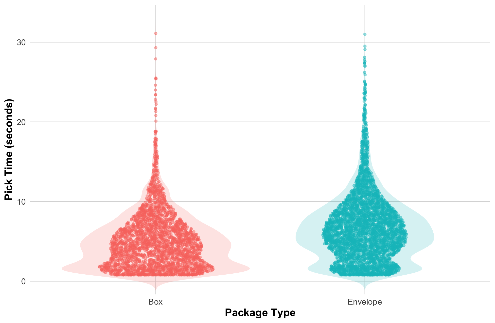

# Amazon Package Pick-Time Analysis

**Matthew Scarpello · Bellevue University · Applied data visualization · 2026**

A driver-inspired R visualization project investigating how package search time can be represented across package types, bags, routes and weeks. The research idea came from questioning whether sorting every package in advance always pays off. The completed coursework focuses on visualization of a simulated workflow, not an experimental comparison of sorting methods.

[Portfolio case study](https://mjscarpello.github.io/Portfolio-Repository/school/amazon-pick-times.html) · [Original report PDF](https://mjscarpello.github.io/Portfolio-Repository/downloads/amazon-workflow-efficiency-report.pdf) · [Data and reproducibility notes](docs/reproducibility.md)



## Selected figures

| # | Figure | Interpretation |
|---|---|---|
| 01 | [Distribution of pick times](figures/selected/amazon-pick-distribution.png) | Violin plot and individual modeled picks: compare the full distributions of boxes and envelopes, not only their means. |
| 02 | [Weekly distributions](figures/selected/amazon-pick-weekly-comparison.png) | Mirrored histograms compare frequency by time bin and week. Their shifts reflect the simulated workflow assumptions. |
| 03 | [A route-level monitor](figures/selected/amazon-pick-rolling-dashboard.png) | A 12-pick rolling mean summarizes local variation; Day 31 concludes at 3.9 seconds relative to a 6-second reference. |
| 04 | [One modeled day: workload share](figures/selected/amazon-pick-day31-workload.png) | Day 31 illustrates 233 packages across 12 bags. Envelopes account for 69.2% of modeled search time. |
| 05 | [Inside individual bags](figures/selected/amazon-pick-bag-level.png) | Faceted bag-level plots show changes in modeled search time as remaining packages decline. Individual bags do not follow identical trajectories. |
| 06 | [The month in aggregate](figures/selected/amazon-pick-month-density.png) | Aggregate curves summarize the modeled association between remaining packages and pick time. The generator explicitly includes a remaining-package effect. |
| 07 | [Monthly workload composition](figures/selected/amazon-pick-month-workload.png) | The January summary represents 6,663 modeled packages across 323 bags; envelopes account for 66.4% of modeled search time. |

## Key reported simulation outputs

- 4.2 seconds mean box pick and 5.6 seconds mean envelope pick, as reported in the original portfolio/report.
- A modeled Day 31 rolling mean of 3.9 seconds against a 6-second reference.
- The January graphic totals 6,663 modeled packages across 323 bags.

These are model/report outputs, not independently verified field measurements. The provided code includes simulated data generation; raw observations and calibration inputs are not present.

## Repository organization

```text
analysis/
  01-milestones/                early simulation and exploratory graphics
  02-monthly-simulation/        bag allocation and alternative pick-time generators
  03-visualizations/            statistical graphic scripts
  04-calibration-exploration/   observed-versus-simulated exploration
archive/full-3.5/               preserved nested source variants
data/                          data availability and privacy notes
docs/                          reproducibility and source manifest
figures/
  original-exports/              untouched PNG/JPEG exports
  milestone-pdf-exports/         original milestone PDF graphics
  selected/                      web-ready curated images
```

All R source files and image exports were preserved from the supplied archives; generated macOS metadata and `.DS_Store` were omitted. `docs/source-inventory.tsv` records original names and checksums. Scripts are original coursework, not a newly tested end-to-end pipeline. See [reproducibility](docs/reproducibility.md) for missing inputs and dependency order.

## Next research stage

Compare the organization strategies fairly, gather anonymized observations from consenting drivers, include initial sorting time and route context, and only then evaluate a predictive recommendation system.

*Independent academic project; not affiliated with or endorsed by Amazon.*
